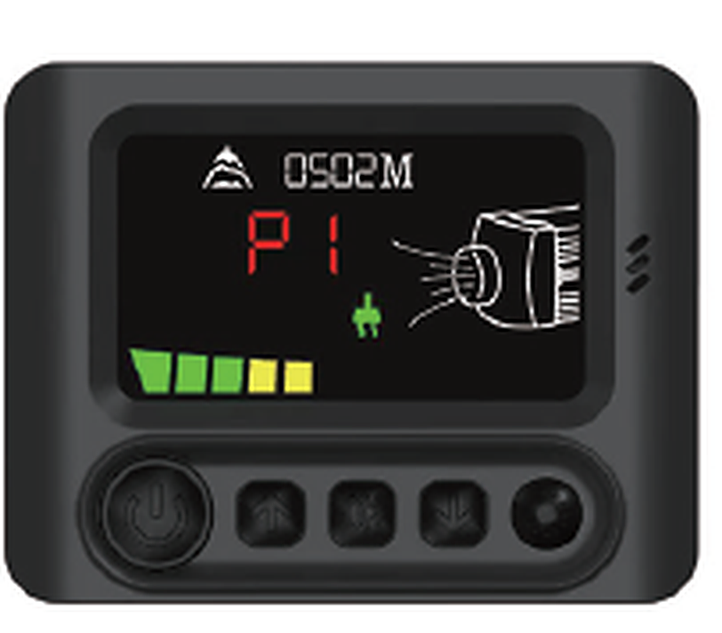

# MXR Parking Heater — ESPHome bridge

Turn a **MaXpeedingRods (MXR) Tuya parking heater** into a local Home Assistant
device: no phone app, no cloud, no vendor account.

An ESP32 replaces the heater's BLE module and speaks both of its internal buses —
so you get real control *and* real telemetry, entirely on your own network.

> Built and tested against the MXR / MaXpeedingRods heater with product key
> `vmdizama`. Other Tuya heaters may speak the same protocol but will have a
> different datapoint map.

---

## The controller



Five keys — on/off, up, OK, down, settings. On/off and up/down are reachable from
this project; OK and settings are panel-only. See the
[controller page](https://github.com/flip555/mxr-parking-heater/wiki/Controller)
for display icons, connectors and the 3.3 V wiring.

---

## What you get

**Control**

- Power on / off
- **Manual** mode — pick a power level, P1–P5
- **Auto** mode — pick a target temperature and let the heater modulate
- Setpoint from 8–36 °C
- Oil prime, with a configurable backstop timer
- Every change confirmed by the heater itself, not assumed

**Monitoring**

- Live power, mode, gear and setpoint
- Current temperature and work state *(once a burner is fitted — see Status)*
- Burner telemetry block, 1 Hz *(documented, not yet mapped)*

**Behaviour that matters**

- **Survives reboots** — the last state is restored from flash and nothing is
  transmitted until boot completes, so the heater is never stomped on restart
- **Follows the panel** — press a button on the heater and Home Assistant updates
  within a second
- **Follows Home Assistant** — command it and the heater applies it and confirms
- **Fully local** — Tuya frames and Modbus on the wire, ESPHome on your LAN. No
  internet, no account, no app

---

## Two ways to install

| | **Monitor only** | **Full control** |
|---|---|---|
| Soldering | none | remove the BLE module |
| Wires | 3 | 4 |
| Hardware | D1 mini is plenty | ESP32 recommended |
| Control from HA | — | yes |
| State + telemetry | yes | yes |

Start with monitor-only. It proves the wiring before you commit to removing
anything, and it is the more reliable build because it needs only one UART.

---

## Quick start

1. **Wire it** — 3 wires for monitoring, 4 for control.
2. **Flash it** — `esphome/d1mini-modbus-monitor.yaml` or
   `esphome/mxr-esp32-control.yaml` from this repo.
3. **Add it** — the device appears in Home Assistant via ESPHome.

Full instructions, photos and pitfalls: **[the wiki](https://github.com/flip555/mxr-parking-heater/wiki)**.

| Page | |
|---|---|
| [Wiring](https://github.com/flip555/mxr-parking-heater/wiki/Wiring) | pin by pin, both builds |
| [Tier 1 — Monitor](https://github.com/flip555/mxr-parking-heater/wiki/Tier-1-Monitor) | three wires, no soldering |
| [Tier 2 — Control](https://github.com/flip555/mxr-parking-heater/wiki/Tier-2-Control) | module removal and full control |
| [Troubleshooting](https://github.com/flip555/mxr-parking-heater/wiki/Troubleshooting) | silent bus, resets, brownouts |
| [FAQ](https://github.com/flip555/mxr-parking-heater/wiki/FAQ) | scope, safety, why it works this way |

---

## Requirements

- MaXpeedingRods / MXR Tuya parking heater (product key `vmdizama`)
- ESP32 (control) or ESP8266 / D1 mini (monitor)
- ESPHome 2025.x or newer
- Home Assistant, if you want the entities — the firmware runs standalone too

---

## Status

**Working:** power, mode, gear, setpoint, state persistence, state correction from
both the panel and Home Assistant, oil prime, and a Modbus decoder for every
controller state change.

**Not yet:** the burner telemetry block. The controller polls 14 registers at
`0x4000` once a second, but nothing answers until a burner is attached — so those
registers are documented as *unknown* rather than guessed.

**Also missing:** current temperature and work state datapoints. They exist and
are mapped from a third-party source, but have not been observed on hardware here.

---

## How it works, briefly

The heater's controller is a Tuya MCU device. Its BT3L module is only a
BLE-to-UART bridge, so an ESP can take its place on the same UART. Separately, the
controller talks Modbus RTU to the burner over a single wire, and mirrors every
settings change onto that bus.

So: **Tuya for commands, Modbus for state.** The ESP keeps its own copy of the
state and treats both buses as corrections, because this firmware has no working
"read everything" command.

Technical detail — frame formats, datapoint ids, register bitfields, and the
documented read-all bug — lives in [`docs/`](docs/) and on the wiki. This README
stays about what the thing *does*.

---

## Repository layout

```
esphome/     ready-to-flash configs (monitor + control)
docs/        protocol reference: Tuya, Modbus, hardware teardown
wiki         setup guides, troubleshooting, FAQ
```

---

## Contributing

The most useful thing you can send is a **capture**: raw frames plus what the
panel was showing at that moment. That is how the register map gets finished.

---

## Licence

MIT.
